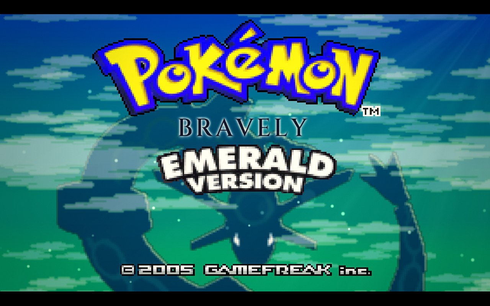
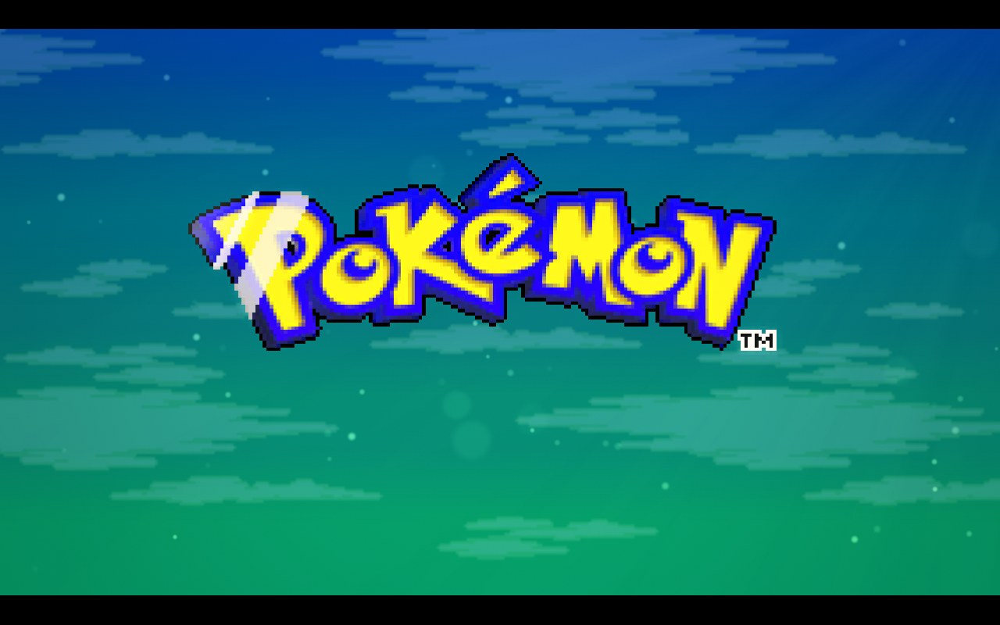
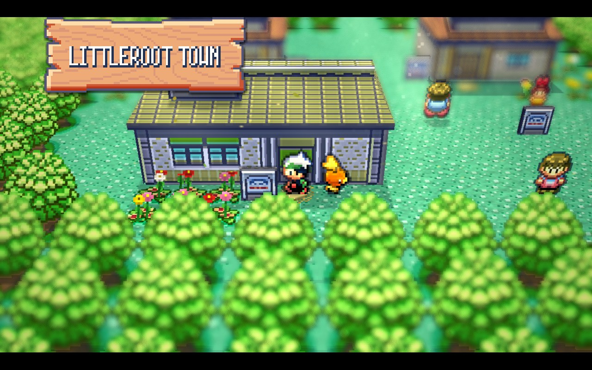
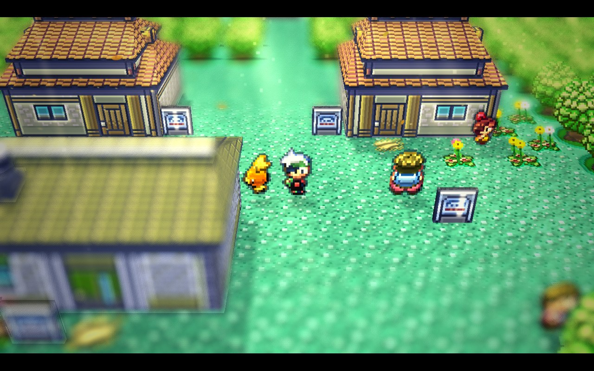
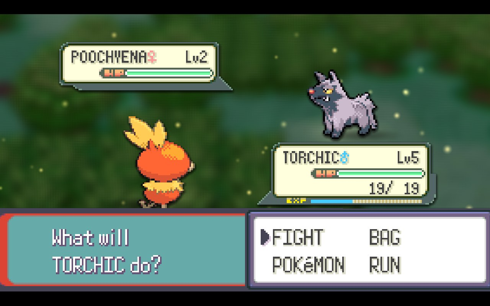
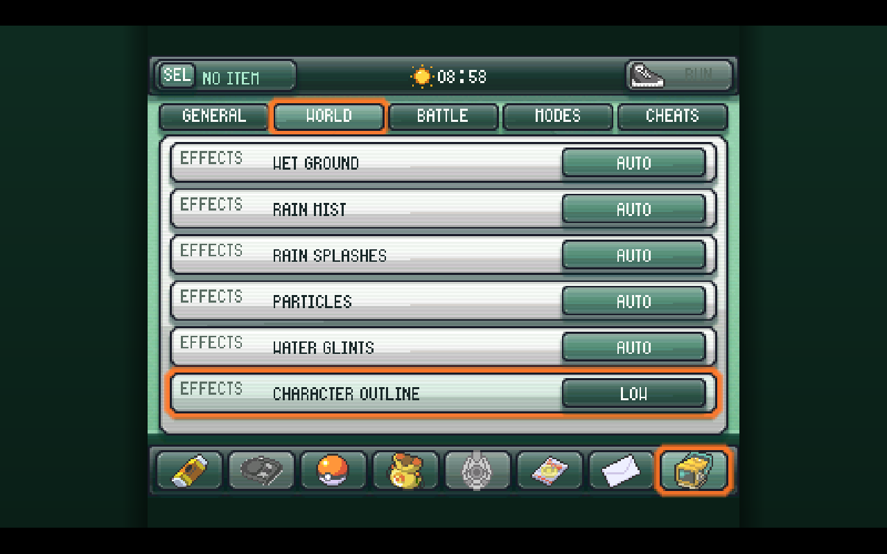
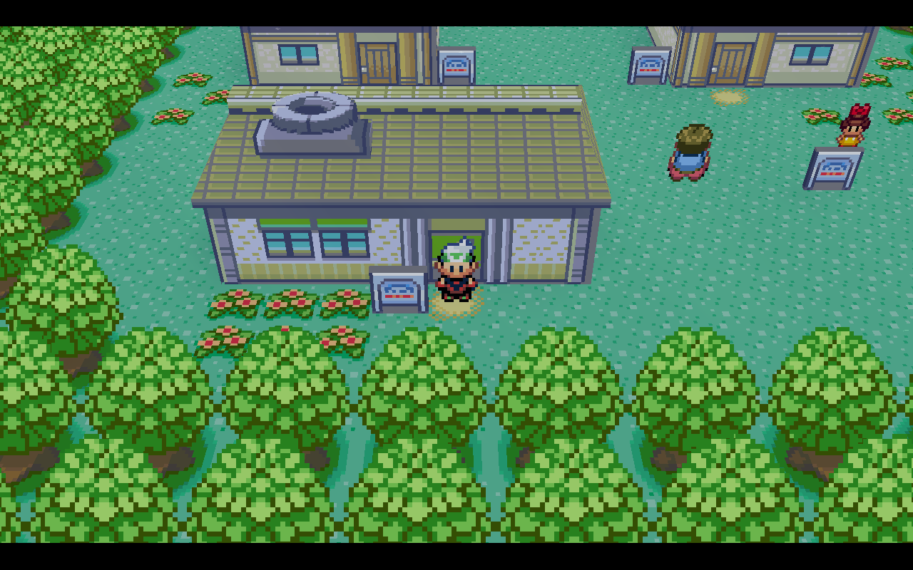
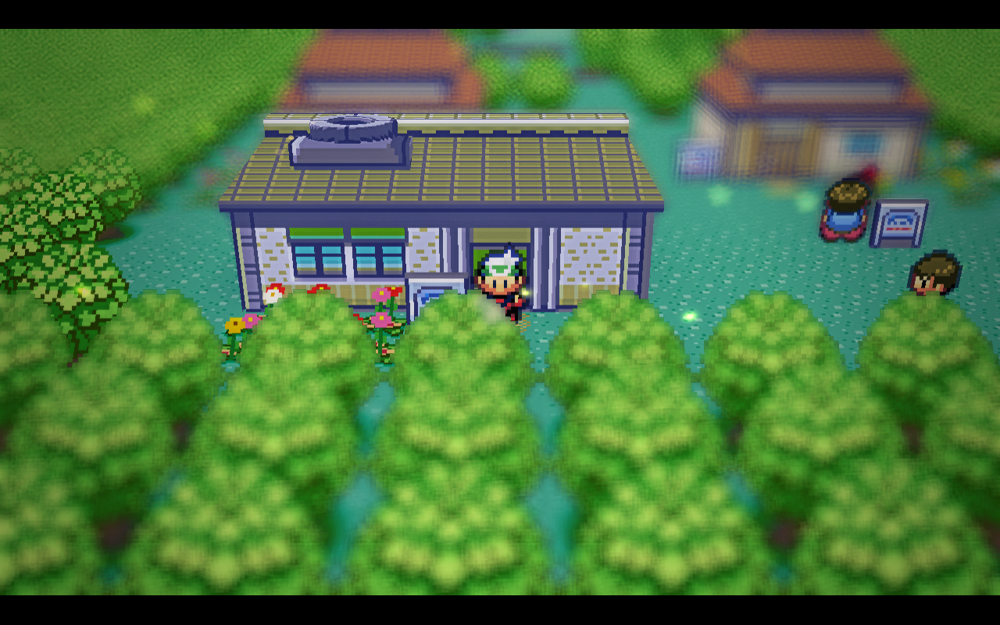
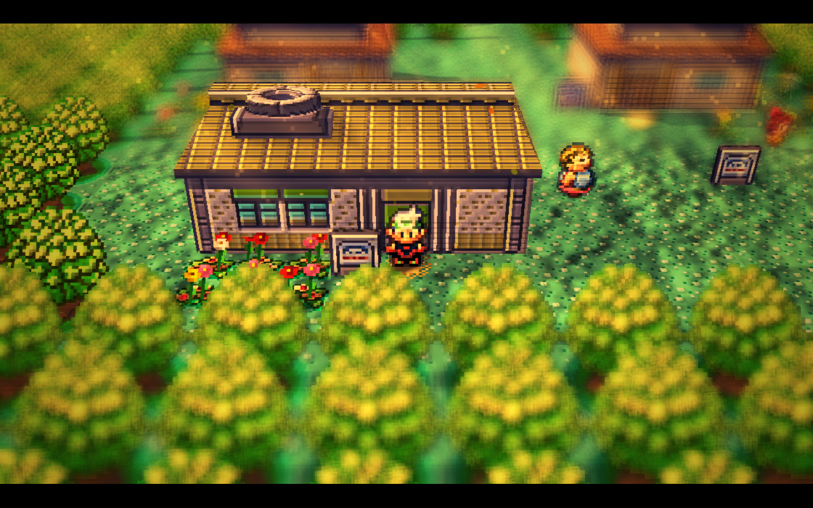

# Pokémon Emerald Vita 3DS

## Steam Deck and Windows ports

This fork adds **native Steam Deck (Linux) and Windows builds** of the voxel Pokémon Emerald port,
and a visual upgrade that only the Deck and Windows builds have. Same game, same save: the 3D
voxel overworld and 3D battles of the Vita port, drawn through a new post-processing chain, with
weather, sound and menu effects on top. It is not an emulator: the decompiled game is compiled to
32-bit x86 and an SDL2 + OpenGL platform layer supplies the GBA hardware.

**No game data is in this repository and no builds are distributed.** You make your own build from
a dump of **your own Pokémon Emerald cartridge** with one script (see [Build](#build)).

### Screenshots

Real captures from a Steam Deck (1280×800, effects on HIGH unless noted).

| | |
|---|---|
|  |  |
| New BRAVELY EMERALD title: the game's own logo and banner with the new lettering, markings and sky. | The reveal: the logo shines in as the flat GBA picture becomes the HD-2D one. |
|  |  |
| Littleroot Town: wooden zone sign, flowers, standing grass, follower, soft shadows and colour grade. | Tilt-shift depth of field and relief on roofs and walls, looking down the street. |
|  |  |
| A 3D wild battle: the stage blurred and dimmed behind the sharp GBA battlers, HP boxes and text. | OPTIONS > WORLD > EFFECTS: every effect has its own row (OFF, AUTO, LOW, MEDIUM, HIGH). |
|  |  |
| Before: the plain voxel picture of the Vita port. | After: the same spot with the new effects on HIGH and a lower camera tilt. |
|  | |
| Dusk grade and light shafts, effects on HIGH. | |

### What it adds (Deck and Windows)

Every effect can be switched off (or set to LOW, MEDIUM, HIGH) from OPTIONS; with everything OFF the
old picture comes back.

- **Post chain**: bloom, colour grade, a time-of-day LUT grade with an S-curve, vignette,
  tilt-shift depth of field that follows the real scene depth, and a selectable scene resolution
  (960, 1120 or 1280 wide). Camera tilt is a setting: CLASSIC (40 degrees), 36, 32, 28 or 24.
- **Light**: sun and moon rays (light shafts) drawn at the angle of the sun or moon for the time of
  day, a real sun shadow map (the baked shadow rays are skipped while it is on), soft blob shadows
  under characters, and a character outline with a warm rim.
- **Surfaces**: relief (a pseudo normal map from the texture art) and ground detail (grass clumps,
  sand ripples, path grain), indoor floors included.
- **Nature**: wind sway on trees and small plants, standing tall grass that bends where the player
  walks, procedural flowers, rain (streaks, wet ground, mist, splashes), pollen, fireflies and
  leaves, water glints.
- **Sound**: a procedural ambient bed (wind, rain, waves, crickets, birds, cave drips, thunder) with
  its own volume (OFF, LOW, MEDIUM, HIGH) and frequency (SPARSE, NORMAL, FREQUENT) rows.
- **Battle**: the 3D backdrop is blurred and dimmed behind the GBA battlers and HP boxes, and move
  hits add a type-coloured flash, glow and screen shake on big hits.
- **Interface polish** (OPTIONS > GENERAL > INTERFACE, original art kept): frosted panel glass,
  time-of-day panel tint, text clarity shadows, a pulsing menu cursor with a sliding trail, menu
  open and close animation, smooth HP and EXP bars, button glyphs (GBA letters or A / B / X / Y in the
  Deck colours), a wide-layout shadow and, in WORLD, a depth glow behind the UI.
- **Title and intro**: the new BRAVELY EMERALD title (lettering in Cinzel, SIL OFL), the reveal
  flash that turns each flat intro picture into the HD-2D one, and intro and menu effects.
- **Platform**: 32-bit static SDL2, controller input, 960×544 picture letterboxed to the screen,
  saves and settings in `userdata/` beside the program.

Details and the constants behind every effect: [docs/DECK_NOTES.md](docs/DECK_NOTES.md).

### Settings reference

Settings live in `userdata/settings.txt` (`key=value`) and in START > OPTIONS. Level rows store
`0` OFF, `1` AUTO (follows EFFECTS PRESET), `2` LOW, `3` MEDIUM, `4` HIGH; any other value counts as
AUTO. Defaults are AUTO unless stated. Rows are those of `src/platform/vita/vita_extras.c`.

| Tab > group | Menu row | Key | Values |
|---|---|---|---|
| GENERAL > SOUND | AMBIENT VOLUME | `ambient_level` | OFF, LOW, MEDIUM (default), HIGH |
| GENERAL > SOUND | AMBIENT FREQUENCY | `ambient_density` | SPARSE (default), NORMAL, FREQUENT |
| GENERAL > INTERFACE | PANEL GLASS, PANEL TINT, TEXT CLARITY, MENU CURSOR, MENU ANIMATION, HP BARS, WIDE UI LAYOUT | `voxel_uiglass`, `voxel_uitint`, `voxel_uitext`, `voxel_uisel`, `voxel_uianim`, `voxel_uibars`, `voxel_uilayout` | levels |
| GENERAL > INTERFACE | BUTTON ICONS | `voxel_uiglyphs` | OFF (port circles), GBA, DECK (default) |
| WORLD > RENDERER | 3D VOXEL DIORAMA | `voxel_3d` | OFF, ON (default) |
| WORLD > RENDERER | DIORAMA BLUR (DOF) | `voxel_blur` | levels |
| WORLD > RENDERER | TARGET FRAMERATE | `voxel_fps` | 30 (default), 60 (stored `0`, `1`) |
| WORLD > EFFECTS | EFFECTS PRESET | `voxel_quality` | LOW, MEDIUM (default), HIGH (stored `0`, `1`, `2`) |
| WORLD > EFFECTS | SHADERS | `voxel_shaders` | OFF (whole legacy path), ON (default) |
| WORLD > EFFECTS | COLOR GRADE, LUT GRADE | `voxel_grade`, `voxel_lut` | levels |
| WORLD > EFFECTS | BLOOM, TILT-SHIFT, 3D RESOLUTION | `voxel_bloom`, `voxel_tiltshift`, `voxel_res` | levels |
| WORLD > EFFECTS | LIGHT SHAFTS, SUN SHADOWS, SOFT SHADOWS | `voxel_shafts`, `voxel_sunshadow`, `voxel_shadow` | levels |
| WORLD > EFFECTS | RELIEF (BUMP), GROUND DETAIL | `voxel_bump`, `voxel_groundrelief` | levels |
| WORLD > EFFECTS | WIND SWAY, GRASS & FLOWERS | `voxel_sway`, `voxel_grass` | levels |
| WORLD > EFFECTS | RAIN STREAKS, WET GROUND, RAIN MIST, RAIN SPLASHES | `voxel_rain`, `voxel_wet`, `voxel_mist`, `voxel_splash` | levels |
| WORLD > EFFECTS | PARTICLES, WATER GLINTS, CHARACTER OUTLINE | `voxel_particles`, `voxel_glint`, `voxel_outline` | levels |
| WORLD > EFFECTS | BATTLE BACKDROP, BATTLE EFFECTS | `voxel_battledim`, `voxel_battlefx` | levels |
| WORLD > EFFECTS | UI DEPTH GLOW | `voxel_uiglow` | levels |
| WORLD > EFFECTS | INTRO EFFECTS | `voxel_flatfx` | levels |
| WORLD > EFFECTS | TITLE SCREEN | `voxel_title` | ORIGINAL, HD-2D (default) |
| WORLD > EFFECTS | REVEAL FLASH | `voxel_reveal` | OFF, ON (default) |
| WORLD > EFFECTS | CAMERA TILT | `voxel_pitch` | CLASSIC, 36, 32 (default), 28, 24 (stored `0` to `4`) |

What each level changes, row by row: [docs/DECK_NOTES.md](docs/DECK_NOTES.md#settings-levels-and-camera-tilt-2026-11-14).
The original (pre-upgrade) look: every effect key `0`, `voxel_res=0`, `voxel_pitch=0`.

### Build

**Steam Deck** (Desktop Mode, no root needed): clone the repository, then

```sh
bash tools/deck/build_deck.sh --rom /path/to/your/emerald.gba
```

It creates an Arch distrobox container, builds the 32-bit libraries and the game, and leaves a
launcher you can add to Steam. Step by step, with Game Mode, saves and troubleshooting:
[docs/BUILD_DECK.md](docs/BUILD_DECK.md).

**Windows** (32-bit build with MSYS2): get the game files once with `fetch_assets.sh`, then run
`tools\windows\build.bat`. See [docs/WINDOWS_BUILD.md](docs/WINDOWS_BUILD.md).

PS Vita builds are not covered by this fork's instructions (the Vita code lineage remains in the tree).

### Performance

Measured on the Steam Deck, see [docs/results/deck-visual-phase1-perf.txt](docs/results/deck-visual-phase1-perf.txt):
before the post effects were added, a 200 s scripted run in the 60 FPS mode presented a frame every
16.67 ms (p99 17.62 ms, 1.2 percent of frames over 17.5 ms). Frame timing with the effects on has
not been measured yet.

### Known issues and unverified

From [docs/HANDOFF.md](docs/HANDOFF.md) and [docs/WINDOWS_BUILD.md](docs/WINDOWS_BUILD.md):

- Not measured or not checked: frame timing with the effects on, real vsync, the 30 FPS mode,
  changing `voxel_res` while playing, dawn, water glints on real water, caves and indoors, crossing
  a map border with the effects on, audio by ear, and Windows on GPUs other than the one it was
  tried on (AMD). Windows: overworld and battle visuals, controller and performance not checked.
- `Fatal error while decompressing LZ file.` is printed once per wild encounter; the game continues.
- At camera tilt 24 with TILT-SHIFT on HIGH the front row of trees is very blurred and covers the
  player's legs. Water tiles get the wet tint in rain. Mauville and Ever Grande flowers are not covered.
- The intro and title margins at 16:9 need `assets/ui/intro_margins.bin`, which `build_deck.sh` makes.
- The PS Vita issues listed further down apply to the Vita build only.

### This fork's credits

Chain of work: [pret/pokeemerald](https://github.com/pret/pokeemerald) (the decompilation) →
[gradenGnostic/pokeemerald-multiplatform](https://github.com/gradenGnostic/pokeemerald-multiplatform)
(the SDL2 platform layer and voxel renderer) → [HctrRB/pokeemerald-vita-3ds](https://github.com/HctrRB/pokeemerald-vita-3ds)
(the PS Vita port with the features of [Emerald 3DS](https://github.com/ZallaxDev/emerald-3ds)) →
this fork (Steam Deck and Windows builds and the visual upgrade). The Deck and Windows work was
written with an AI coding assistant (Claude Code, by Anthropic) under the supervision of
marcoscodas. The title lettering is Cinzel, under the SIL Open Font License
([docs/licenses/Cinzel-OFL.txt](docs/licenses/Cinzel-OFL.txt)). The full list is under
[Credits](#credits) and in [NOTICE.md](NOTICE.md).

---

## PS Vita port

Unofficial native PS Vita port of Pokémon Emerald, built from the
[pret/pokeemerald](https://github.com/pret/pokeemerald) decompilation. It is not an emulator:
the game's C code is compiled for the Vita's ARM CPU, and a platform layer supplies what the GBA
hardware did. On top of it, the port brings the features of
[Emerald 3DS](https://github.com/ZallaxDev/emerald-3ds) to the Vita with vitaGL:

- a 3D voxel overworld built live from the game's maps, with sun, shadows, day/night and weather;
- 3D battles on a stage taken from the map where the battle starts;
- a new touch interface over the 3D world that replaces the GBA menus and boxes, with five
  menu themes;
- HGSS follower Pokémon, an accelerated clock, time-based encounters and optional QoL extras.

The full list is under [Features](#features).

> **AI-assisted project.** The code, build scripts and documentation were written with an AI
> coding assistant (Claude Code, by Anthropic) under the supervision of HctrRB, who sets the
> direction, reviews the changes and tests every build on a real PS Vita.

> **Legal notice.** Pokémon and Pokémon Emerald are © Nintendo, Creatures Inc. and GAME FREAK inc.
> This project is not affiliated with or endorsed by them. This repository does not contain the
> game's graphics, sounds or binary data, nor any ROM: to build, you check a dump of **your own
> cartridge** and the game files are downloaded from the public decompilation
> (see [Build](#build)). Like every decompilation, the tree still holds the game's code and text
> in decompiled form. A build contains Nintendo's data: **do not distribute builds or the
> downloaded files**.

## Features

### 3D world

- Voxel overworld built live from the game's maps: sun and shadows, day/night cycle, weather,
  depth of field, water reflections, 3D buildings and trees. 30 or 60 FPS (OPTIONS > WORLD).
- 3D battles: the stage is picked from the map around the player, and the camera glides from
  the field into it.
- Wild encounters in the 3D world fade smoothly into the battle.
- HGSS follower Pokémon, an accelerated clock and time-based encounters.

### New interface (OPTIONS > MODES > NEW UI (TEST), off by default)

Drawn natively at 960×544 over the 3D world. Every screen works with the buttons and with touch
(first tap selects, a second tap on the selection confirms).

- **START menu**: Pokédex (list, entry, cry, size, area), party (summary pages, switch, held
  items, field moves, move reorder), bag (pockets, sort, use / give / toss / register), PokéNav
  (map, Match Call, condition, ribbons), Fly map, trainer card, Nuzlocke tracker, options, save.
- **PC boxes**: withdraw, deposit, move POKéMON and items, release, marks, jump to a box,
  wallpapers (the game's own, Walda's included) and box names.
- **Scenes the scripts open**: Poké Mart buy / sell, naming keyboard (player, rival, POKéMON,
  boxes), Easy Chat (mail, profile, battle messages, interviews, trendy saying, survey…), berry
  choice for the Berry Blender and Berry Crush, contest appeal choice, "choose a POKéMON" for
  the move tutor, the Day Care and other scripts.
- **Battle**: HUD with health plates, party balls, commands, moves with PP and type, targets in
  double battles, YES / NO, level-up stats and the Safari Zone; bag and party in battle (multi
  battles included); the Battle Pyramid bag.
- **Field**: dialogue box, YES / NO, choice lists (PC menus, NPC questions), money box, item
  obtained, PokéNav calls and zone signs with each town's motto.
- **Menu themes** (OPTIONS > GENERAL > MENU COLOR): RED (default), EMERALD, CRYSTAL, TROPICAL
  and ROYAL. Each has its own colours, box shapes, bevels and font, and applies to every screen,
  the battle HUD and the zone signs.

### Extras

Physical / special split, infinite TMs, running indoors, IV / EV pages, EXP Share and EXP
multiplier, Nuzlocke rules, field HM shortcuts, button remapping.

## Status

> **Work in progress, in active testing.** Expect bugs, crashes and unfinished screens. If you
> find one, please [open an issue](../../issues/new/choose) with the bug report template: what
> you did, what happened, and the log files from `ux0:data/POKEVITA/`. Feedback on screens
> that are missing or feel wrong is very welcome.

Performance: 60 FPS with drops to 55 at 333 / 166 MHz.

### Not yet tested on a PS Vita

These parts build and run in the design mocks, but have not been checked on the console yet:

- The menu themes on every screen, the battle HUD in each theme, and the lighter TROPICAL font.
- PC boxes: moving, withdrawing, depositing, releasing, marks, wallpapers and box names.
- Naming keyboard: new game, box names, nicknames, a POKéMON caught with a full party.
- Easy Chat in each of its uses, the berry choice and the contest appeal choice.
- Day Care and move tutor choice (the right POKéMON is taken, the screen fades back in).
- The dialogue box after PokéNav calls and YES / NO answers (it used to flicker).
- The words of the PC choice menus, larger POKéMON names in battle.
- The fade into wild battles in the 3D world.
- Evolutions and some other scenes.

### Known issues and gaps

- Still on the GBA interface: the summary of a boxed POKéMON in the PC, the Battle Pyramid bag
  inside battles and its "bag full: choose what to drop" step, and Easy Chat's Bard song and
  quiz screens.
- Some UI screens are still missing: give feedback on the ones you find.
- The menu can freeze sometimes.
- Terrain generation bugs in some maps (they come from Emerald 3DS).
- The shop buy / sell flow over the 3D world with the new UI off still has visual glitches.
- Walda's FRIENDS wallpaper may draw without its frame.
- Trainer and legendary battle transitions are the GBA ones and only partly show over the 3D
  world.
- Link and recorded battles, Wally's catching tutorial and the Battle Arena judgment keep the
  GBA battle HUD.
- Intro and title screen margins at 16:9 are broken (sprites cut at the GBA edge, streaks
  beside Rayquaza); a replacement is designed in [docs/SCENES_16_9.md](docs/SCENES_16_9.md).
- Occasional frame drops in dense areas of the 3D overworld.
- Vita3K shows a black screen; test on hardware.

## Repository layout

```
CMakeLists.txt, build_*.sh/.ps1      CMake build (Deck and Windows; the Vita scripts remain)
make_tools.mk, *_rules.mk, vita/     host tools, asset rules, Vita-lineage platform files
src/, include/, asm/, data/,         the pokeemerald decompilation (game code and text data;
constants/                           graphics/, sound/ and data binaries come from fetch_assets)
fetch_assets.sh/.ps1, tools/assets/  game files download (checks your ROM, then the manifest)
src/platform/                        GBA hardware emulation and main loop
src/platform/voxel/                  3D voxel world
src/platform/vita/                   native UI and Vita-specific features
assets/                              port data (voxel, UI art, followers)
tools/                               pret host tools and the UI art generators (tools/ui_gen)
docs/                                technical documentation
```

## Controls

| Button | Action |
|---|---|
| Cross / Circle | A / B |
| D-pad or left stick | Move |
| L / R | L / R |
| START | Open or close the touch menu (field) |
| SELECT | Registered item |
| Triangle | Fast forward |
| Square | Options |
| Touch | Menu, battle action deck |

Buttons can be remapped in Options. Settings and saves live in `ux0:data/POKEVITA/`
(see [docs/ARCHITECTURE.md](docs/ARCHITECTURE.md#runtime-files-ux0datapokevita)).

## Documentation

| Document | Covers |
|---|---|
| [docs/BUILD_DECK.md](docs/BUILD_DECK.md) | Build for the Steam Deck, step by step |
| [docs/WINDOWS_BUILD.md](docs/WINDOWS_BUILD.md) | The 32-bit Windows build (MSYS2) |
| [docs/BUILD.md](docs/BUILD.md) | Build overview: host tools, game assets, CMake options |
| [docs/README.md](docs/README.md) | Index of the technical documentation |
| [docs/ARCHITECTURE.md](docs/ARCHITECTURE.md) | Layers, boot, one frame, where things are, runtime files |
| [docs/THREADS.md](docs/THREADS.md) | Cores, pacing, who owns which data |
| [docs/RENDERING.md](docs/RENDERING.md) | Presentation paths, voxel passes, GBA overlay, GPU rules |
| [docs/VITA_UI.md](docs/VITA_UI.md) | The new UI and the original Vita UI |
| [docs/VOXEL_ENGINE.md](docs/VOXEL_ENGINE.md) | The 3D overworld |
| [docs/SCENES_16_9.md](docs/SCENES_16_9.md) | How GBA screens fill 16:9 |
| [docs/ASSETS.md](docs/ASSETS.md) | Where every data file comes from |
| [docs/DEBUGGING.md](docs/DEBUGGING.md) | Logs, per-frame telemetry, crash dumps |
| [design/stitch/README.md](design/stitch/README.md) | Design mocks of the new UI (Spanish) |
| [CONTRIBUTING.md](CONTRIBUTING.md) | Code standards and workflow |
| [NOTICE.md](NOTICE.md) | Licences of the ported code and credits |

## Credits

- **pret** and contributors: the pokeemerald decompilation and its tools.
- **Zallax** and the Emerald 3DS contributors: [Emerald 3DS](https://github.com/ZallaxDev/emerald-3ds),
  the source of most of what this port adds: the voxel world, the 3D battles, the followers, the
  extras and the look of the interface.
- **gradenGnostic** and contributors:
  [pokeemerald-multiplatform](https://github.com/gradenGnostic/pokeemerald-multiplatform), the SDL2
  platform layer and voxel renderer this port starts from.
- **Rinnegatamante** (vitaGL), the **VitaSDK**, **SDL** and **Vita3K** teams, **Dave Gamble**
  (cJSON) and **Niels Lohmann** (nlohmann/json).
- **HctrRB**: project lead, supervision and hardware testing.

## Legal

- Pokémon, Pokémon Emerald and all related names, characters, graphics, music and text are
  trademarks and copyrights of Nintendo, Creatures Inc. and GAME FREAK inc. This is a
  non-commercial fan project.
- This repository does not include the game's graphics, sounds or binary data, nor any ROM.
  `fetch_assets` checks a dump of the user's own cartridge and downloads those files from the
  public pret/pokeemerald decompilation (via pokeemerald-multiplatform); they remain the property
  of their owners. The decompiled code and text in this tree come from the same decompilation.
  Builds contain that material: don't upload, share or sell them. Use this project only with a
  legitimately owned copy of Pokémon Emerald.
- Code licences differ by origin: MIT for the multiplatform layer and original Vita code
  ([LICENSE](LICENSE)), **CC BY-NC-SA 4.0** for everything derived from Emerald 3DS. The full list
  is in [NOTICE.md](NOTICE.md).
- Provided as is, without warranty. Rights holders can request changes or removal by opening an
  issue.
