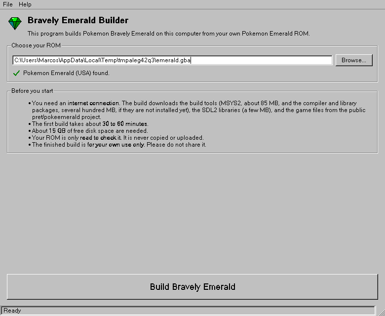
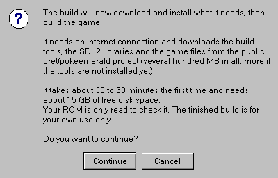
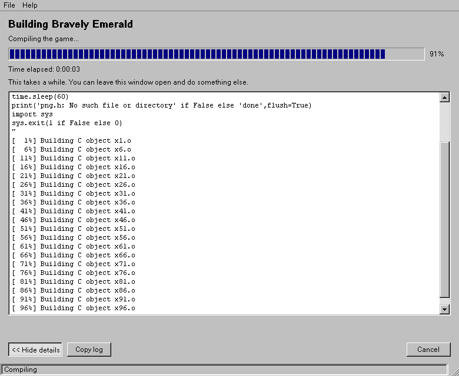
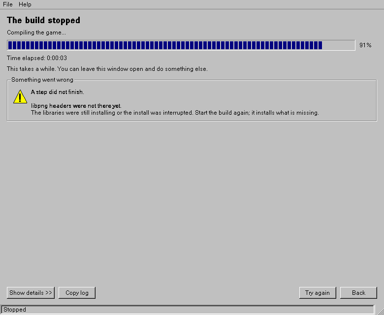
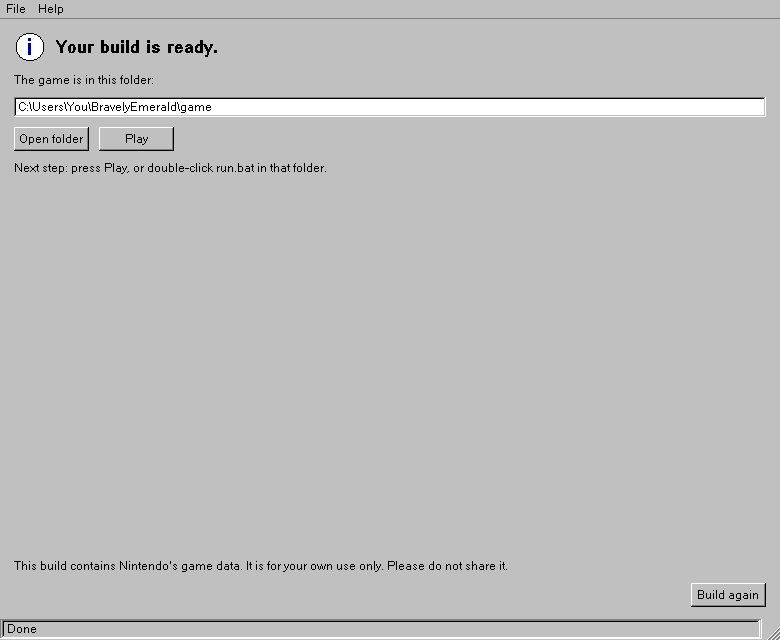

# The builder app

A small desktop program (Python 3 and Qt through PySide6, in the look of a 1995 installer) that builds the game from
**your own Pokemon Emerald dump**, for Windows or for Linux and the Steam Deck. You choose the ROM and press one button.
The program carries the project source inside it, checks the computer, installs what is missing, gets the game files,
compiles and packs the game. It runs the existing build scripts (`tools/deck/build_deck.sh`, `fetch_assets.sh` and
`tools/windows/*`) as subprocesses; it does not replace them.



Legal note first: the repository holds no ROM and no game data, and neither does the app. The result of a build
contains Nintendo's data. Use it yourself and **do not share it**. The ROM is only read to check it (by
`fetch_assets.sh`); it is never copied, stored or uploaded.

## Standalone for the repository, not for the toolchain

The package contains everything of this repository that a build needs, so the only thing you supply is the ROM. It
does **not** contain the toolchain or the game files. During the build, and only after you confirm it once, the
program downloads automatically:

* Windows: the MSYS2 installer (about 85 MB, official, from github.com/msys2) and the compiler and library packages
  (several hundred MB) if they are not installed yet. Linux and Steam Deck: an Arch Linux build container (about
  400 MB) and its compiler packages.
* The SDL2 2.32.10 and SDL2_image 2.8.12 sources (a few MB, checked against SHA-256 values on Linux).
* The game files from the public pret/pokeemerald decompilation (through pokeemerald-multiplatform), each file checked
  against `tools/assets/manifest.txt`.

So you need an internet connection, about 15 GB of free disk space and, the first time, 30 to 60 minutes.

## Install and run

**Windows.** Download `BravelyEmeraldBuilder-win.zip`, unzip it anywhere, run `BravelyEmeraldBuilder.exe`. No Python is
needed. (There is no installer yet; an Inno Setup or NSIS installer can be added later.)

**Linux, SteamOS.** Unpack `BravelyEmeraldBuilder-linux-x86_64.tar.gz`, then `sh install.sh` (copies it to
`~/.local/share/bravely-emerald-builder` and adds a menu entry; `sh install.sh --uninstall` removes it). On a Deck use
Desktop Mode.

**From source.** With the repository cloned: `pip install PySide6` (PySide6-Essentials is enough), then
`python tools/builder/app.py`. A source checkout is used as the repository, unless a package archive was made next to
the app (`tools/builder/bundle/`, written by `package.py`); then that snapshot is used, as in the packaged app.
`--repo DIR` always wins. Other options: `--dry-run` (the log shows every command, nothing runs), `--smoke` (open the
window and quit, a self test), `--selftest` (extract the bundled source and dry-run this host's build, no window),
`--build --rom FILE --out DIR [--jobs N] [--low]` (build without a window; for tests).

## The screens

**Main screen.** The title and one line of what it does; *Choose your ROM* with a Browse button and the result under
it (a tick and "Pokemon Emerald (USA) found.", or a short reason); the notice *Before you start* (internet, what is
downloaded, 30 to 60 minutes, 15 GB, the ROM is only read, own use only); and **Build Bravely Emerald**. The target is
chosen from the computer: a Windows exe on Windows, the Linux 32-bit (Steam Deck) build on Linux and SteamOS.
The prerequisite check runs by itself in the background at start and only shows a problem when it stops the build.



The button asks one question (Continue or Cancel) that repeats the download notice. Then everything runs without more
decisions: check the computer, install the build tools, get the game files, compile, package.



**While building:** a progress bar (the classic segmented bar), the step in plain words, the elapsed time, *Cancel*
(stops the whole process tree) and *Show details >>* for the live log. *Copy log* copies it. When a step fails the program shows a short
explanation and the suggested fix from the table of known errors, with *Try again* (it resumes: finished steps are
skipped), *Copy log* and *Show details*.



**Ready.** "Your build is ready." with the folder, *Open folder*, *Play*, and one line of next step (Windows: press
Play or double-click `run.bat`; Linux and Deck: add the launcher to Steam, with a Help button).



**File, Settings.** Install folder (default `%USERPROFILE%\BravelyEmerald\game` on Windows, `~/emerald-deck` on
Linux), CPU usage (Low is the default: half of the threads at low priority; Normal three quarters; High all), the source
(work folder, *Use my own checkout*, *Re-extract bundled source*), the Linux container name and start-up test, a button
that lists the result of the computer check, and the place of the build logs.
**Help, Contents** opens `docs/BUILDER_HELP.md`, bundled in the app and rendered inside it (no browser, no network): the Steam Game
Mode steps, saves, settings, troubleshooting and the legal text.

Choices are remembered in `bravely_builder_settings.json` next to the app (or in `~/.config/bravely-builder` when that
folder is not writable): paths and option values only, never ROM contents.

## The bundled source

`package.py` runs `git archive` on the current commit (tracked files only: no `.git`, no virtualenv, no builds, no game
data) and drops what no build needs: `docs/` except `docs/licenses/`, `design/` except `design/stitch/_tools/` (the
design exporter that `fetch_assets.sh` runs), `tools/builder/`, `.github/`, the Vita and `build_all` scripts, README and
CONTRIBUTING. The result is `bundle/source.tar.xz` plus `source-manifest.json` (commit, date, file count, sha256 of the
archive, the exclude list), stored inside the app. The list was proven by a real build from the package.

On first run, or when the bundled version differs from the extracted one, the app unpacks it into a work folder
(`%LOCALAPPDATA%\BravelyEmerald\source`, `~/.local/share/bravely-emerald/source`; `BRAVELY_BUILDER_HOME` moves it for tests) and
builds there; the build output goes to the separate install folder. Extraction checks the archive hash against the
manifest first, refuses absolute paths, `..`, drive letters, links and special files, goes through a staging folder that is
renamed into place, and an update only rewrites files whose content changed, so `build-win/deps`, `.assets_ok` and the
downloaded game files survive and a second build is fast. A marker file says when an extraction is incomplete, and an
interrupted one is repeated. A folder that the app did not create is never overwritten. A checkout of your own (Settings) is only read.

## What it runs

| Host | Commands |
|---|---|
| Windows | If missing: the MSYS2 installer (silent, `--confirm-command --accept-messages --root`) and `pacman -Syu`, `pacman -S --needed` of the packages in `docs/WINDOWS_BUILD.md`. Then, in MSYS2 (`C:\msys64`): `fetch_assets.sh` (`FETCH_NO_CONVERT=1`, accepted to stop at "Generating the port's files"), `make -f make_tools.mk`, `make -f vita/assets.mk`, `fetch_assets.sh` again, `tools/windows/build.sh`, `tools/windows/package.sh`, and a copy of `dist-win` to the install folder that never overwrites saves or settings. |
| Linux, SteamOS | `bash tools/deck/build_deck.sh --dir D --jobs N --container C [--rom R] [--no-run]`: the script makes the container, the toolchain, SDL2 and the game. A missing `distrobox` or `podman` stops the build with the exact command to run in a terminal. |

The job count of the Windows build reaches `build.sh` through `OMP_NUM_THREADS` (GNU `nproc` honours it). Low priority is the
Windows `BELOW_NORMAL` priority class or `nice -n 19`.

## Security model

* **No passwords.** The program never asks for, reads or stores a password; if something needs administrator rights it shows
  the command to run in a terminal.
* **No shell strings.** Commands are argument lists. For MSYS2 the script text is constant and every path is passed as a
  positional argument, so a path cannot inject commands. Paths from the window are validated: absolute, no control
  characters, no quotes or shell symbols, no spaces for the paths the scripts use.
* **Downloads need consent**, given once in the confirmation box. The program itself downloads only the MSYS2 installer; the
  rest is downloaded by the build scripts.
* Settings are whitelisted by key and type. The program listens on no port.

## Layout and extending

```
tools/builder/
  app.py            entry point (Qt)           cli.py   headless driver of the core
  core/             no Qt: tested without a display
    host.py  constants.py  validate.py  errors.py  settings.py  tasks.py  repo.py
    builder.py      targets, checks, command construction, runner, installs, results
    source.py       bundled source: manifest, safe extraction, update, which repository is used
  ui/               classic.py (Windows 95 look), main_window.py (the screen), dialogs.py (Settings, Help)
  tests/            test_core.py, test_source.py, test_ui.py (offscreen), shots.py (renders every screen to PNG)
  package.py        bundle + PyInstaller        packaging/  Linux install files, container build script
docs/BUILDER_HELP.md   the Help page (bundled into the app)
```

* A new known error: add a `(regex, title, fix)` row to `core/errors.py` and a case to `ErrorTableTests`.
* A new prerequisite: add it in `Builder._checks_windows` or `_checks_linux`.
* A new stage: add a `(regex, stage)` rule to the `Step` and the words in `STEP_TEXT` in `ui/main_window.py`.
* Tests: `python -m unittest discover -s tools/builder/tests -v` (the window tests need PySide6; on Windows with the offscreen
  platform set `QT_QPA_FONTDIR=C:\Windows\Fonts`). `BRAVELY_TEST_ROM` adds a check against a real dump.
  `BRAVELY_FAKE_HOST=steamos` (with `--dry-run`) shows the Linux command construction on any machine.
* Screens: `python tools/builder/tests/shots.py OUTDIR`.

## Look

Qt's classic `Windows` style with a classic palette (face `#C0C0C0`, navy `#000080`, tooltip `#FFFFE1`), a small sans UI font, no
style sheet, no gradients, no rounded corners. It is built into Qt, so Linux looks the same. The window keeps the native
frame; it does not fake a title bar.

## Packaging

PyInstaller has to run on the OS it targets.

```sh
python -m venv .venv-builder
.venv-builder/bin/pip install PySide6-Essentials pyinstaller      # Scripts\pip on Windows
.venv-builder/bin/python tools/builder/package.py
```

Windows makes `tools/builder/dist-builder/BravelyEmeraldBuilder-win.zip`. Linux makes the `.tar.gz` with `install.sh` and the
`.desktop` template. On a Steam Deck run `bash tools/builder/packaging/build_linux_in_container.sh`: it creates a fresh container
(never the game's `emerald-build`), installs Python and git in it, runs `package.py` and removes the container.

## Relation to the Emerald 3DS web builder

The [Emerald 3DS builder](https://github.com/ZallaxDev/emerald-3ds/tree/main/builder) runs in the browser (Pyodide) because their
game executable is prebuilt and independent of the game data: the builder only packs the data from the ROM into a `.pak`. Our
builds compile the decompiled game with Nintendo's graphics and data linked into the executable, so a prebuilt downloadable
executable would distribute game data, and a 32-bit native compiler cannot run in a browser. A browser-only builder is therefore not
possible here and its code is not reused (it is also under CC BY-NC-SA 4.0). This app runs on your computer and nothing leaves it.

## Tested and not verified

See the hand-off report of the change for the exact runs. Not verified unless noted there: the Linux and Steam Deck target beyond
command construction, the Linux package, the MSYS2 install on a computer without MSYS2, and Game Mode start-up (as in `BUILD_DECK.md`).
