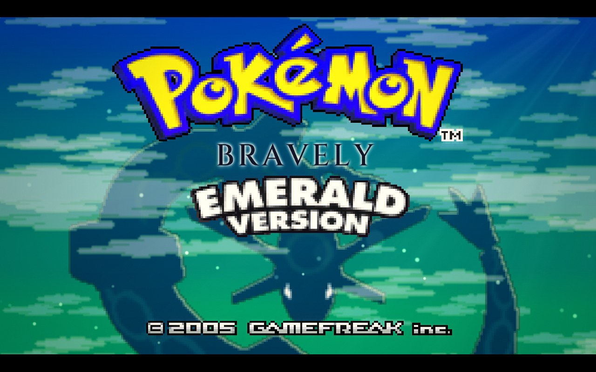
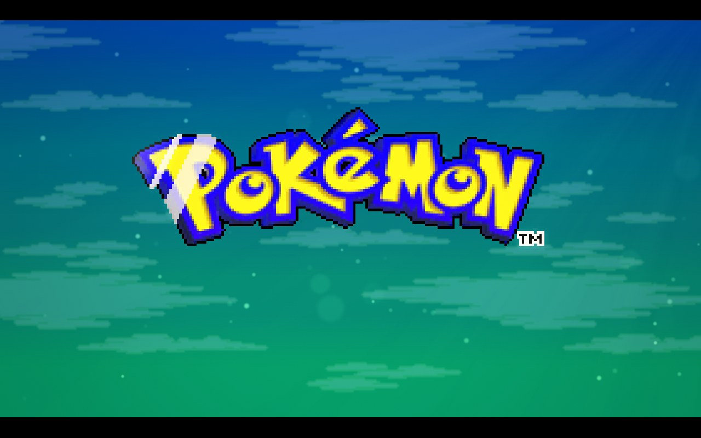
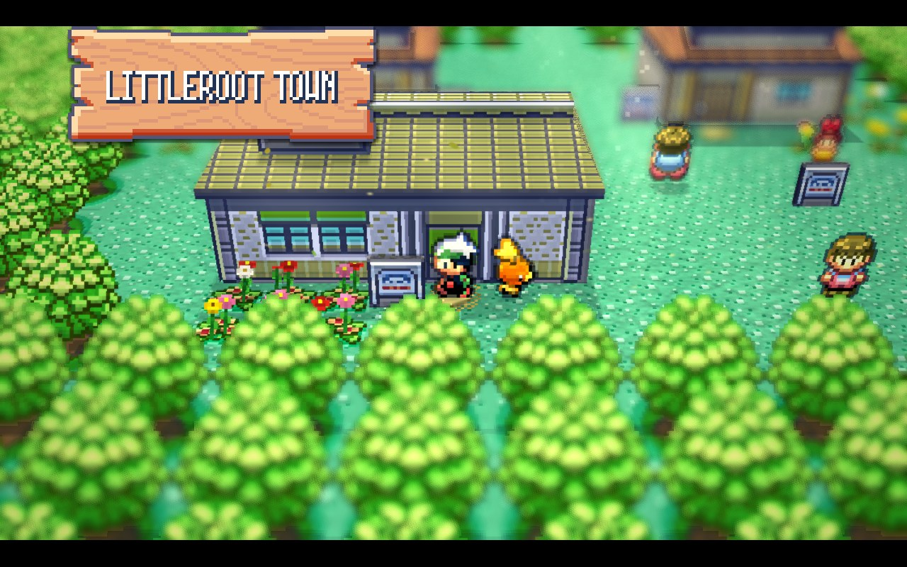
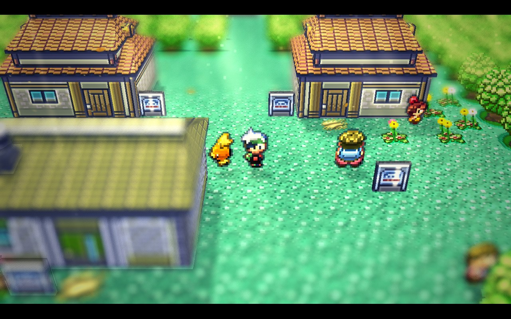
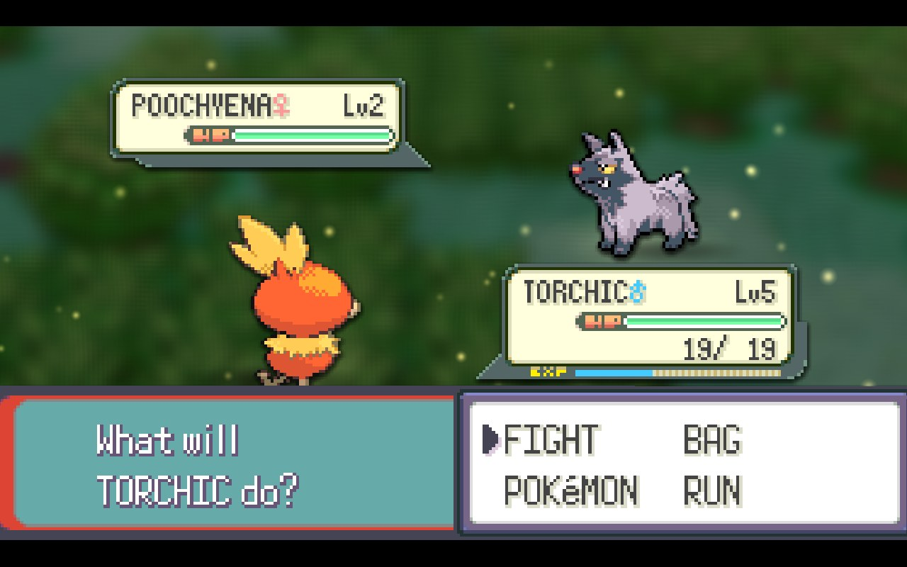
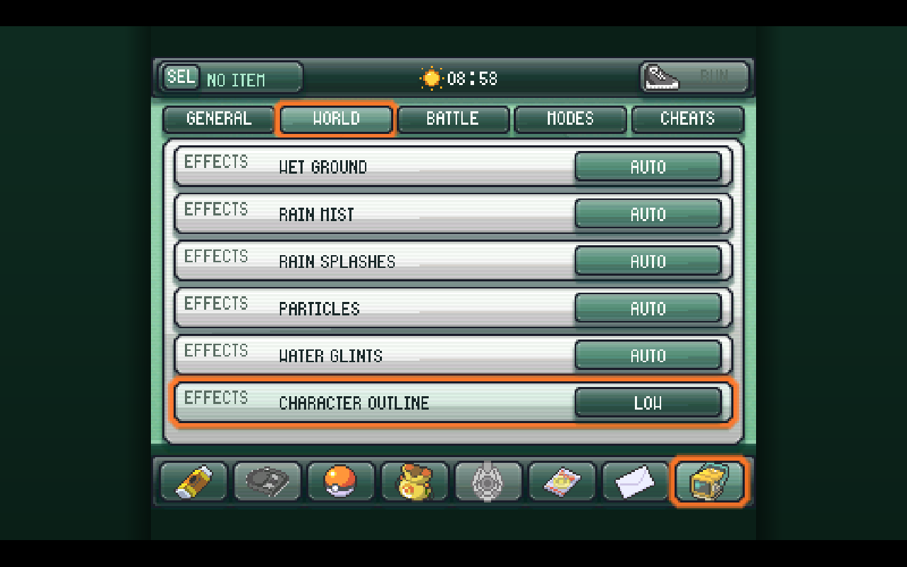
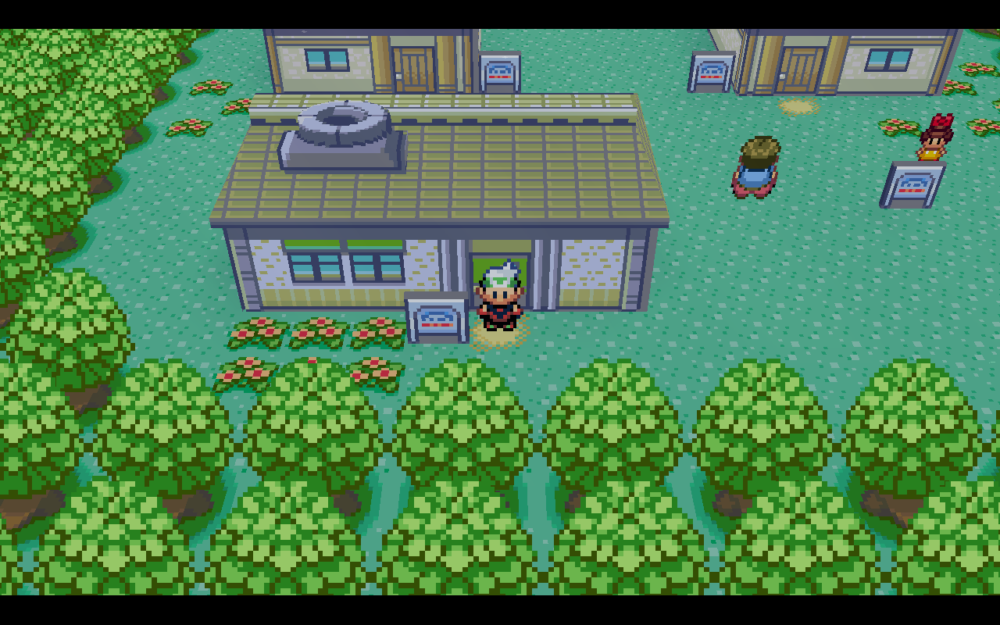
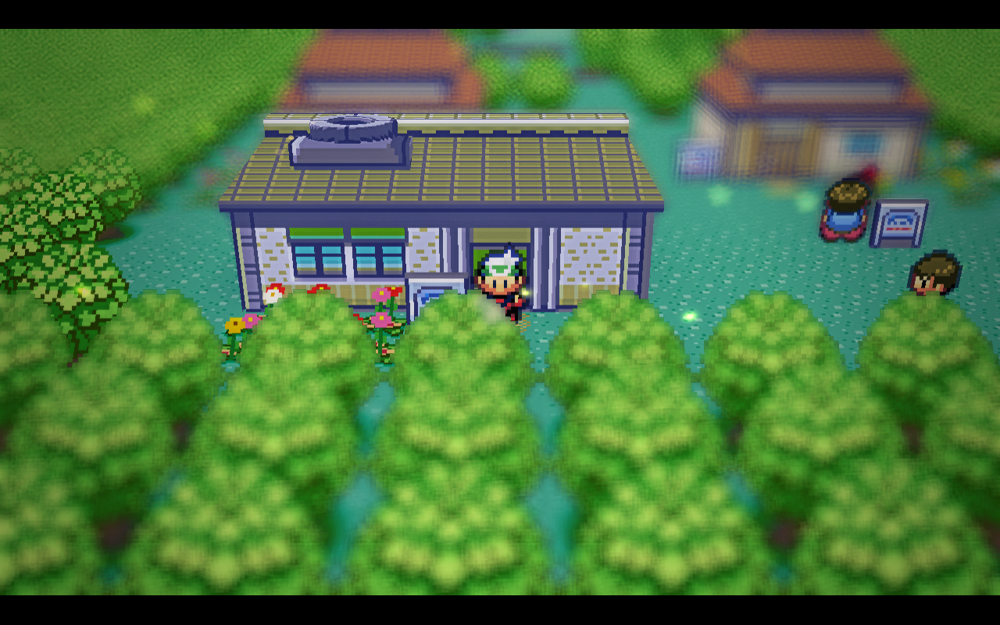
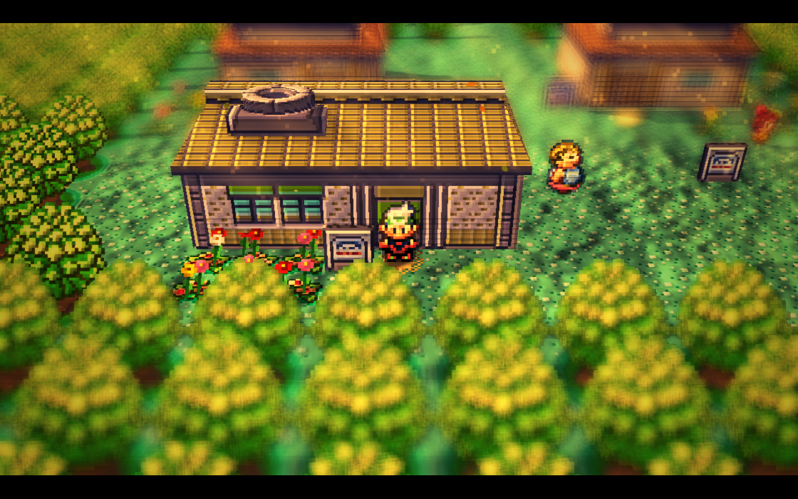

# Features and settings

What the Steam Deck and Windows builds add to the 3D voxel port. Every effect has its own
setting (OFF, LOW, MEDIUM or HIGH) in START > OPTIONS; with everything OFF the plain voxel picture
comes back. The constants behind each effect are in [DECK_NOTES.md](DECK_NOTES.md).

All pictures here were taken on a Steam Deck at 1280x800 with the effects on HIGH unless noted.

| | |
|---|---|
|  |  |
| The BRAVELY EMERALD title: the game's own logo and banner with new lettering, markings and sky. | The reveal: the logo shines in as the flat GBA picture becomes the HD-2D one. |
|  |  |
| Littleroot Town: wooden zone sign, flowers, standing grass, follower, soft shadows and colour grade. | Depth of field and relief on roofs and walls, looking down the street. |
|  |  |
| A wild battle: the stage blurred and dimmed behind the sharp battlers, HP boxes and text. | OPTIONS > WORLD > EFFECTS: one row per effect. |
|  |  |
| The plain voxel picture of the Vita port. | The same spot with the new effects on HIGH and a lower camera tilt. |
|  | |
| Dusk grade and light shafts. | |

## By area

Post chain
: Bloom, colour grade, a time-of-day LUT grade with an S-curve, vignette, tilt-shift depth of field
that follows the real scene depth, and a selectable scene resolution (960, 1120 or 1280 wide).
Camera tilt is a setting: CLASSIC (40 degrees), 36, 32, 28 or 24.

Light
: Sun and moon rays drawn at the angle of the sun or moon for the time of day, a real sun shadow map
(the baked shadow rays are skipped while it is on), soft blob shadows under characters, and a
character outline with a warm rim.

Surfaces
: Relief (a pseudo normal map from the texture art) and ground detail (grass clumps, sand ripples,
path grain), indoor floors included.

Nature
: Wind sway on trees and small plants, standing tall grass that bends where the player walks,
procedural flowers, rain (streaks, wet ground, mist, splashes), pollen, fireflies and leaves, water
glints.

Sound
: A procedural ambient bed (wind, rain, waves, crickets, birds, cave drips, thunder) with its own
volume (OFF, LOW, MEDIUM, HIGH) and frequency (SPARSE, NORMAL, FREQUENT) rows.

Battle
: The 3D backdrop is blurred and dimmed behind the GBA battlers and HP boxes. Move hits add a
type-coloured flash, glow and screen shake on big hits.

Interface (OPTIONS > GENERAL > INTERFACE, original art kept)
: Frosted panel glass, time-of-day panel tint, text clarity shadows, a pulsing menu cursor with a
sliding trail, menu open and close animation, smooth HP and EXP bars, button glyphs (GBA letters or
A / B / X / Y in the Deck colours), a wide-layout shadow and, in WORLD, a depth glow behind the UI.

Title and intro
: The BRAVELY EMERALD title (lettering in Cinzel, SIL OFL), the reveal flash that turns each flat
intro picture into the HD-2D one, and intro and menu effects.

Platform
: 32-bit static SDL2, controller input, 960x544 picture letterboxed to the screen, saves and
settings in `userdata/` beside the program.

## Settings reference

Settings live in `userdata/settings.txt` (`key=value`) and in START > OPTIONS. Level rows store
`0` OFF, `1` AUTO (follows EFFECTS PRESET), `2` LOW, `3` MEDIUM, `4` HIGH; any other value counts as
AUTO. Defaults are AUTO unless stated. The rows are those of `src/platform/vita/vita_extras.c`.

| Tab > group | Menu row | Key | Values |
|---|---|---|---|
| GENERAL > SOUND | AMBIENT VOLUME | `ambient_level` | OFF, LOW, MEDIUM (default), HIGH |
| GENERAL > SOUND | AMBIENT FREQUENCY | `ambient_density` | SPARSE (default), NORMAL, FREQUENT |
| GENERAL > INTERFACE | PANEL GLASS, PANEL TINT, TEXT CLARITY, MENU CURSOR, MENU ANIMATION, HP BARS, WIDE UI LAYOUT | `voxel_uiglass`, `voxel_uitint`, `voxel_uitext`, `voxel_uisel`, `voxel_uianim`, `voxel_uibars`, `voxel_uilayout` | levels |
| GENERAL > INTERFACE | BUTTON ICONS | `voxel_uiglyphs` | OFF (port circles), GBA, DECK (default) |
| WORLD > RENDERER | 3D VOXEL DIORAMA | `voxel_3d` | OFF, ON (default) |
| WORLD > RENDERER | DIORAMA BLUR (DOF) | `voxel_blur` | levels |
| WORLD > RENDERER | TARGET FRAMERATE | `voxel_fps` | 30 (default), 60 (stored `0`, `1`) |
| WORLD > EFFECTS | EFFECTS PRESET | `voxel_quality` | LOW, MEDIUM (default), HIGH (stored `0`, `1`, `2`) |
| WORLD > EFFECTS | SHADERS | `voxel_shaders` | OFF (whole legacy path), ON (default) |
| WORLD > EFFECTS | COLOR GRADE, LUT GRADE | `voxel_grade`, `voxel_lut` | levels |
| WORLD > EFFECTS | BLOOM, TILT-SHIFT, 3D RESOLUTION | `voxel_bloom`, `voxel_tiltshift`, `voxel_res` | levels |
| WORLD > EFFECTS | LIGHT SHAFTS, SUN SHADOWS, SOFT SHADOWS | `voxel_shafts`, `voxel_sunshadow`, `voxel_shadow` | levels |
| WORLD > EFFECTS | RELIEF (BUMP), GROUND DETAIL | `voxel_bump`, `voxel_groundrelief` | levels |
| WORLD > EFFECTS | WIND SWAY, GRASS & FLOWERS | `voxel_sway`, `voxel_grass` | levels |
| WORLD > EFFECTS | RAIN STREAKS, WET GROUND, RAIN MIST, RAIN SPLASHES | `voxel_rain`, `voxel_wet`, `voxel_mist`, `voxel_splash` | levels |
| WORLD > EFFECTS | PARTICLES, WATER GLINTS, CHARACTER OUTLINE | `voxel_particles`, `voxel_glint`, `voxel_outline` | levels |
| WORLD > EFFECTS | BATTLE BACKDROP, BATTLE EFFECTS | `voxel_battledim`, `voxel_battlefx` | levels |
| WORLD > EFFECTS | UI DEPTH GLOW | `voxel_uiglow` | levels |
| WORLD > EFFECTS | INTRO EFFECTS | `voxel_flatfx` | levels |
| WORLD > EFFECTS | TITLE SCREEN | `voxel_title` | ORIGINAL, HD-2D (default) |
| WORLD > EFFECTS | REVEAL FLASH | `voxel_reveal` | OFF, ON (default) |
| WORLD > EFFECTS | CAMERA TILT | `voxel_pitch` | CLASSIC, 36, 32 (default), 28, 24 (stored `0` to `4`) |

What each level changes, row by row: [DECK_NOTES.md](DECK_NOTES.md).

The original (pre-upgrade) look: every effect key `0`, `voxel_res=0`, `voxel_pitch=0`.
